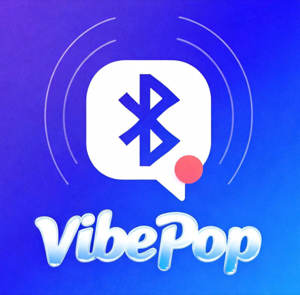

# VibePop — fork français



[🇫🇷 Français](README.md) · [🇬🇧 English](README_en.md) · [🇨🇳 中文](README_zh.md)

[](https://github.com/mondary/vibepop/releases/latest)
[](https://github.com/daloyanf/vibepop/releases/tag/v1.1.2)
[](LICENSE)

VibePop affiche un popup personnalisable quand un écouteur Bluetooth sélectionné se connecte. Cette branche `fr-live` ajoute une interface française et permet d’attribuer un média différent à chaque appareil.

## Médias et lecture

- Le drawer met le média actif au premier plan et permet de le remplacer depuis le sélecteur Android.
- Des visuels intégrés restent disponibles en un geste.
- Les vidéos peuvent être lues une fois puis fermer le popup, ou boucler jusqu’à la fin du compte à rebours.
- La durée du popup et la sortie audio se règlent dans les options globales.

## Installation

Téléchargez le [dernier APK français](https://github.com/mondary/vibepop/releases/latest/download/VibePop-fr.apk), puis ouvrez le fichier téléchargé sur Android.

- Android 8.0 (API 26) ou plus récent.
- Activez les permissions Bluetooth, notifications et superposition demandées par l’application.

## Build et tests

Prérequis : JDK 17 et Android SDK.

```bash
./gradlew test
./gradlew assembleDebug
```

Consultez le [CHANGELOG](CHANGELOG.md) pour l’historique complet. Les notes du projet amont sont conservées dans [README_zh.md](README_zh.md).

## Soutenir

[❤️ Soutenir ce projet sur Ko-fi](https://ko-fi.com/pouark)

## Licence

[MIT](LICENSE)
