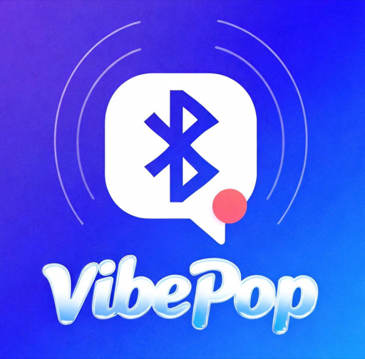

# VibePop — French fork

[🇫🇷 Français](README.md) · [🇬🇧 English](README_en.md) · [🇨🇳 中文](README_zh.md)

The `fr-live` branch is the French-maintained Android fork of VibePop. It displays a customizable popup when selected Bluetooth earbuds connect and supports per-device media.

## Current media drawer

- The active media is shown first and can be replaced from the media picker.
- Included visuals remain available as one-tap choices.
- Video media can play once and close, or loop until the popup countdown ends.
- Popup duration and audio routing remain in the global settings.
- Settings include a non-blocking Ko-fi support link.

## Download and build

- [Download the latest French APK](https://github.com/mondary/vibepop/releases/latest/download/VibePop-fr.apk)
- Run `./gradlew test` and `./gradlew assembleDebug` with JDK 17.
- Minimum Android version: Android 8.0 (API 26).
- Grant the Bluetooth, notification and overlay permissions requested by the app.

See [CHANGELOG.md](CHANGELOG.md) for version history and [README_zh.md](README_zh.md) for the upstream project notes.

## Support

[Support VibePop on Ko-fi](https://ko-fi.com/pouark).

## License

[MIT](LICENSE)
