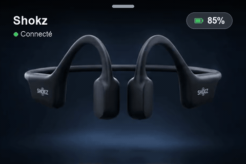
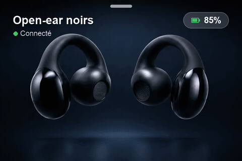
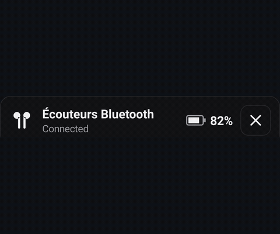

# PK Bluetooth

Version source **2026.11.20**

> Application Android qui affiche un popup personnalisé quand un appareil Bluetooth se connecte, enregistre ses niveaux de batterie réels et échange des fichiers entre vos appareils.
> Construite sur [VibePop](https://github.com/daloyanf/vibepop), avec des styles de popup adaptés de [BudPop](https://github.com/AweSanjam/BudPop) et des fonctions batterie/partage inspirées de [btManage](https://github.com/fhnb16/btManage-android). Voir [les notices](THIRD_PARTY_NOTICES.md).


[🇬🇧 English](README.md) · [🇫🇷 Français](README_fr.md)

PK Bluetooth est une application indépendante (`design.mondary.pkbluetooth`) : elle s'installe à côté de VibePop, et aucune des deux ne met l'autre à jour. Le popup apparaît à la connexion d'un appareil listé en liste blanche, y compris sur l'écran de verrouillé ; chaque appareil peut avoir son média, son nom et sa durée.

## Aperçu du popup

| Shokz | Open-ear noirs | Peugeot 3008 |
| :---: | :---: | :---: |
|  |  |  |

Ces aperçus reprennent les visuels intégrés et la mise en page réelle du popup : nom de l’appareil, état de connexion et batterie. Le niveau reste inconnu (`--%`) quand l’appareil ne le transmet pas.

## Styles d’animation

| Minimal | Lovely | Fanciest |
| :---: | :---: | :---: |
|  |  |  |

Aperçus des trois styles, rendus depuis les vraies vues de l’application en mode sombre.

## Téléchargement et mises à jour

- [Découvrir la présentation de PK Bluetooth](https://mondary.design/apps/pk-bluetooth/).

- [Télécharger le dernier APK signé](https://github.com/mondary/Android_PKbluetooth/releases/latest/download/Android_PKbluetooth.apk).
- Depuis l'app : Réglages → Mises à jour → **VÉRIFIER**. Si une nouvelle version est disponible, l'app ouvre le téléchargement de l'APK signé ; Android demande de confirmer l'installation. L'installation n'est pas silencieuse.
- Toutes les versions utilisent la même clé privée de signature : les mises à jour s'installent sur cette version. Gardez la clé secrète et ne désinstallez pas l'app pour la mettre à jour.

## Popup et médias

- La fiche s’ouvre sur le visuel ou l’animation active ; le visuel intégré sélectionné est entouré et Explorer donne accès aux fichiers Android.
- L’atelier sépare les onglets **Visuel** et **Animation**. Parcourez les familles BudPop et lancez leur aperçu animé dans le panneau avant de choisir.
- L’historique batterie est visible dans chaque fiche ; les réglages proposent **Appareil par défaut** et les crédits et licences en bas de page. Les partages fichier/Wi‑Fi ouvrent des outils généraux et ne ciblent pas automatiquement l’appareil Bluetooth sélectionné.
- Les vidéos se lisent une fois puis ferment le popup, ou bouclent jusqu'à la fin du compte à rebours.
- Trois styles de carte BudPop — minimal, lovely, fanciest — avec neuf familles d'appareils (écouteurs, casques, enceintes, barres de son, claviers, souris, adaptateurs voiture, manettes, générique), dessinées à la volée en Kotlin. La famille est détectée depuis l'appareil, ou forcée par appareil.
- Le bouton de test rejoue toujours la configuration exacte du popup de la cible courante.

## Batterie

- Seuls les niveaux réellement transmis par l'appareil sont enregistrés, dans une base SQLite locale, dédoublonnés, conservés 30 jours.
- L'historique liste les 500 dernières mesures de l'appareil sélectionné, avec une courbe sur 24 heures ; il se partage en texte.
- Les appareils qui ne remontent rien via Android sont lus via le service GATT Batterie standard (et les bracelets Huami via leur caractéristique propre).
- Un widget d'écran d'accueil affiche le dernier niveau de quatre appareils.

## Partage

- **Partage navigateur** : une page servie sur le réseau local ; tout appareil disposant du lien peut récupérer les fichiers proposés et renvoyer fichiers ou texte. HTTP en clair sur un réseau de confiance, protégé par une clé aléatoire, révoquée à l'arrêt.
- **Android_PKbluetooth vers Android_PKbluetooth** : deux installations se découvrent sur le réseau local, s'appairent une fois par un code à six chiffres, puis échangent fichiers et texte dans les deux sens. Chaque connexion est authentifiée mutuellement par une clé propre à l'installation qui ne quitte jamais le Keystore Android ; un pair oublié ne peut plus se reconnecter.
- Les éléments reçus arrivent dans une boîte de réception privée, ouverts ou transférés via le menu de partage Android.

## Build et tests

JDK 17 et un SDK Android.

```bash
./gradlew test assembleDebug
```

Les releases signées et le manifeste de mise à jour sont publiés par GitHub Actions lorsqu'un tag `v*` est poussé. Les vérifications de partage de bout en bout s'exécutent sur un appareil ou un émulateur :

```bash
./gradlew assembleDebugAndroidTest
adb install -r app/build/outputs/apk/debug/app-debug.apk
adb install -r app/build/outputs/apk/androidTest/debug/app-debug-androidTest.apk
adb shell am instrument -w design.mondary.pkbluetooth.test/com.vibepop.qa.IntegrationRunner
```

Consultez le [CHANGELOG](CHANGELOG.md) pour l'historique complet et le [projet VibePop d’origine](https://github.com/daloyanf/vibepop) pour sa documentation.

## Soutenir

[❤️ Soutenir ce projet sur Ko-fi](https://ko-fi.com/pouark)

## Licence

[MIT](LICENSE)
